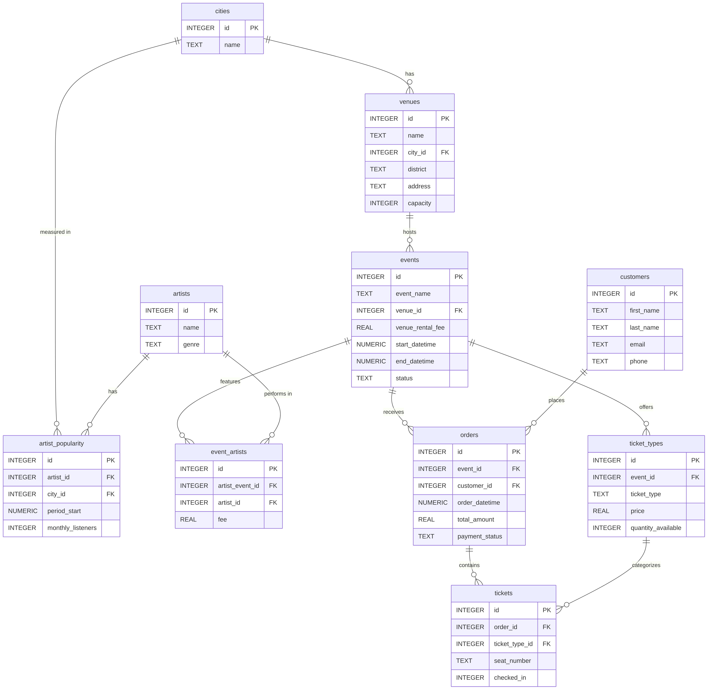

# CS50-Introduction-to-Databases-with-SQL-2026 Solutions

## Disclaimer

**Note:** These solutions are intended for educational purposes only. The primary goal is to provide guidance and assistance to individuals working on the CS50-SQL course offered by Harvard University. Use these solutions responsibly, ensuring that you understand the concepts covered in each problem before referring to the solutions.

## Overview

This repository contains my solutions to the CS50-SQL course assignments. The solutions are organized by week, covering the material presented in each respective week of the course.

## Course Information

CS50-SQL is a course offered by Harvard University, focusing on the fundamentals of SQL (Structured Query Language) and database management. For more information about the course, including the syllabus, lectures, and additional resources, please visit the [CS50-SQL official website](https://cs50.harvard.edu/sql/).

# Solutions

- [Week 0 Problem Set](https://cs50.harvard.edu/sql/2024/psets/0/)
  * [cyberchase](Week_0/cyberchase)
  * [normals](Week_0/normals)
  * [players](Week_0/players)

- [Week 1 Problem Set](https://cs50.harvard.edu/sql/2024/psets/1/)
  * [moneyball](Week_1/moneyball)
  * [dese](Week_1/dese)
  * [packages](Week_1/packages)

- [Week 2 Problem Set](https://cs50.harvard.edu/sql/2024/psets/2/)
  * [connect](Week_2/connect)
  * [donuts](Week_2/donuts)

- [Week 3 Problem Set](https://cs50.harvard.edu/sql/2024/psets/3/)
  * [dont-panic](Week_3/dont-panic)
  * [meteorites](Week_3/meteorites)

- [Week 4 Problem Set](https://cs50.harvard.edu/sql/2024/psets/4/)
  * [census](Week_4/census)
  * [private](Week_4/private)

- [Week 5 Problem Set](https://cs50.harvard.edu/sql/2024/psets/5/)
  * [harvard](Week_5/harvard)

- [Week 6 Problem Set](https://cs50.harvard.edu/sql/2024/psets/6/)
  * [dont-panic-python](Week_6/dont-panic-python)
  * [sentimental-connect](Week_6/sentimental-connect)

- [Final Project](https://cs50.harvard.edu/sql/2024/project/)
  * [My Solution](https://github.com/aybikecetinus/CS50-Introduction-to-Databases-with-SQL/tree/main/FINAL%20PROJECT)

  
